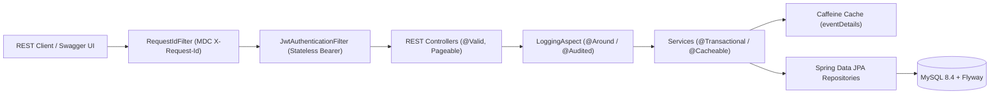
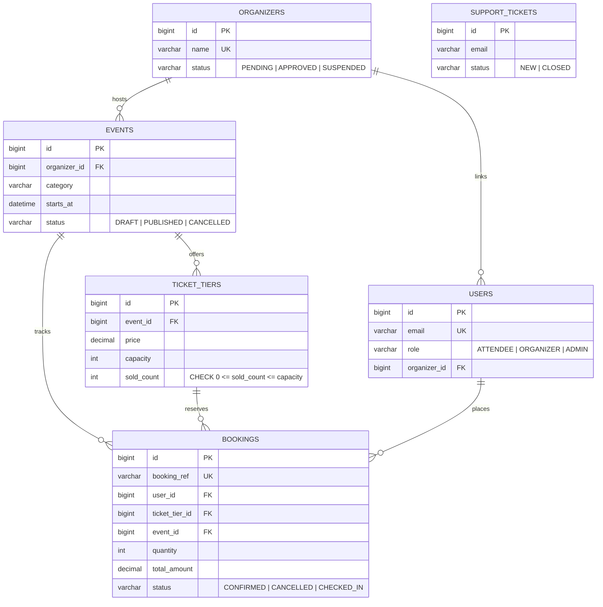

# EventPass

Event ticketing REST API built with **Java 25** and **Spring Boot 4.1.1**, engineered for atomic seat inventory under concurrent booking load, strict role-based isolation, and production-ready container deployment.

[](https://github.com/harsh-rajjj/eventpass/actions/workflows/ci.yml)


---

## Overview

EventPass models the full lifecycle of a live-event ticketing platform across three roles (`ATTENDEE`, `ORGANIZER`, `ADMIN`):

- **Public Catalog & Support:** Multi-filter, paginated event discovery (`city`, `category`, date range, keyword), Caffeine-cached event details, and public support ticket submission.
- **Attendee Bookings:** Concurrent-safe ticket reservations with per-event ticket caps, unique booking references (`EP-...`), booking history, and 24-hour cutoff self-service cancellation that atomically restores inventory.
- **Organizer Self-Service & Gate Check-In:** Organization profile management, draft/publish/cancel event lifecycle (cancelling an event cascades to all confirmed bookings), ticket tier CRUD, attendee manifest lookup, and single-use gate check-in.
- **Admin Governance:** Organizer approval queue, atomic organizer suspension (suspends the organization, bulk-unpublishes its events, and evicts cache in one transaction), and support ticket resolution.

---

## Tech Stack

| Layer | Technology |
|---|---|
| **Runtime & Framework** | Java 25 (LTS), Spring Boot 4.1.1, Spring MVC, Bean Validation |
| **Security** | Spring Security 7 (stateless), JJWT `0.12.6`, BCrypt, Have I Been Pwned password check |
| **Persistence** | Spring Data JPA, Hibernate (`open-in-view: false`, `ddl-auto: validate`), MySQL 8.4, Flyway |
| **Caching & AOP** | Caffeine (`eventDetails` cache), Spring AOP (`@Audited` & service latency logging) |
| **Observability & Docs** | SLF4J + Logback (MDC `X-Request-Id`), Spring Boot Actuator, SpringDoc OpenAPI 3 (`3.0.3`), RFC 9457 `ProblemDetail` |
| **Testing & Delivery** | JUnit 5, MockMvc (`@WebMvcTest`), `@DataJpaTest`, Testcontainers (`mysql:8.4`), GitHub Actions CI, multi-stage Alpine `Dockerfile` |

---

## Architecture & Domain Model

### Request Pipeline



### Entity-Relationship Diagram

Schema is managed strictly through versioned Flyway migrations (`V1`–`V5`) with database-level `CHECK`, `UNIQUE`, and `FOREIGN KEY` constraints plus composite query indexes.



---

## Key Engineering Decisions

### 1. Zero Overselling & Same-User Cap Enforcement Under Concurrency
Ticket inventory is never updated with a read-modify-write cycle in Java. Instead, `BookingService` enforces two database-backed invariants inside a single transaction:
- **Atomic Conditional Seat Reservation:** `TicketTierRepository.reserveSeats` executes a single atomic `UPDATE ticket_tiers SET sold_count = sold_count + :qty WHERE id = :id AND sold_count + :qty <= capacity`. A `0`-row update throws `SoldOutException` (`409 Conflict`), backed by a MySQL `CHECK (sold_count >= 0 AND sold_count <= capacity)` constraint.
- **Closing the Same-User Cap Race under InnoDB `REPEATABLE READ`:** The first query in `createBooking` locks the attendee's `users` row via `@Lock(LockModeType.PESSIMISTIC_WRITE)` (`SELECT ... FOR UPDATE`). Concurrent requests from the *same* user serialize before reading their existing booking sum (enforcing the 6-ticket-per-event cap), while different attendees book concurrently without contending on each other.
- **Verified by:** `BookingServiceTest` (50 threads racing via `CountDownLatch` for 10 seats → exactly 10 bookings created, 40 rejected with `409`, `soldCount == 10`; plus a concurrent same-user cap race test) and `TicketTierRepositoryTest` running against a real MySQL 8.4 Testcontainer.

### 2. Transactional Atomicity & Real Rollback Verification
Suspending an organizer (`AdminOrganizerService.suspend`) updates the organizer's status to `SUSPENDED` and bulk-unpublishes all its `PUBLISHED` events via `@Modifying(flushAutomatically = true, clearAutomatically = true)` within one `@Transactional` boundary.
- **Verified by:** `AdminOrganizerServiceRollbackTest` injects a runtime failure *inside* `suspend()` through a JDK dynamic proxy around `EventRepository`, then queries MySQL in a fresh persistence context to prove the organizer's status rolled back cleanly to `APPROVED`.

### 3. N+1 Query Prevention & Bounded Pagination
- `spring.jpa.open-in-view: false` keeps database connections out of JSON serialization.
- Public event search (`EventRepository.searchPublishedEvents`) pairs `JOIN FETCH` with an explicit `countQuery` for clean SQL pagination; detail and tier lookups use `@EntityGraph`, with `hibernate.default_batch_fetch_size: 20` as a fallback for lazy collections.
- All paged endpoints return a stable `PageResponse<T>` DTO, enforce `spring.data.web.pageable.max-page-size: 50`, and map invalid sort properties (`PropertyReferenceException`) to `400 Bad Request` `ProblemDetail` responses.

### 4. Caching Strategy & Multi-Node Trade-Off
- `CacheConfig` configures a bounded Caffeine cache (`eventDetails`, `maximumSize(500)`, `5m` write TTL) storing immutable `EventDetailResponse` DTOs rather than managed JPA entities.
- Event updates, tier mutations, and booking reserve/cancel operations trigger targeted `@CacheEvict(key = "#eventId")`; organizer profile edits and suspensions evict with `allEntries = true`. Cache hit and eviction paths are verified in `EventCachingTest`.
- **Trade-off:** Caffeine gives zero-network-hop latency for a single application instance. Scaling horizontally across multiple nodes would swap the `CacheManager` bean to Redis without changing service-layer annotations.

### 5. Stateless Security, RFC 9457 Errors & Request Observability
- Stateless JWT filter chain (`SecurityConfig`) validates HMAC-SHA bearer tokens (`JwtAuthenticationFilter`), defensively rejects missing/malformed role claims, hashes passwords with BCrypt, and screens registrations against Have I Been Pwned (`CompromisedPasswordChecker`) with a fail-open fallback if the external API is unreachable.
- Both `GlobalExceptionHandler` and security filter handlers (`RestAuthenticationEntryPoint` `401`, `RestAccessDeniedHandler` `403`) serialize RFC 9457 `ProblemDetail` JSON using Jackson 3 `JsonMapper`.
- `RequestIdFilter` propagates `X-Request-Id` into SLF4J MDC and every HTTP response; `LoggingAspect` logs service execution times and `@Audited` admin/organizer mutations; `logback-spring.xml` switches formatting by active Spring profile.

### 6. 12-Factor Configuration & Profile Isolation
- Typed `@Validated @ConfigurationProperties` records (`JwtProperties`, `BookingProperties`, `CorsProperties`) bind `app.*` settings and fail fast on startup if required properties are missing or invalid (tested in `ConfigurationPropertiesBindingTest`).
- `dev` activates sample Flyway seed data (`db/seed`) and `DevSeedAccountInitializer`; `prod` disables Spring Docker Compose auto-start, excludes seed SQL, and requires all secrets and CORS origins via environment variables (see [`.env.example`](.env.example)).

---

## API Reference

Interactive documentation is available at `/swagger-ui/index.html` (OpenAPI JSON at `/v3/api-docs`), and a ready-to-import collection with automatic JWT/variable capture is included at [`postman/EventPass.postman_collection.json`](postman/EventPass.postman_collection.json).

### Public & Operations

| Method | Path | Description |
|---|---|---|
| `GET` | `/actuator/health` | Container/load-balancer health probe (`show-details: never`) |
| `POST` | `/api/v1/auth/register` | Register a new `ATTENDEE` account |
| `POST` | `/api/v1/auth/register/organizer` | Register a new `ORGANIZER` account + `PENDING` organization |
| `POST` | `/api/v1/auth/login` | Authenticate with email/password and receive a Bearer JWT |
| `GET` | `/api/v1/events` | Search `PUBLISHED` events (`city`, `category`, `from`, `to`, `q`, `page`, `size`, `sort`) |
| `GET` | `/api/v1/events/{id}` | Get `PUBLISHED` event details and ticket tiers (cached) |
| `POST` | `/api/v1/support-tickets` | Submit a public support request |

### Attendee (`ROLE_ATTENDEE`)

| Method | Path | Description |
|---|---|---|
| `POST` | `/api/v1/bookings` | Atomically reserve tickets and create a `CONFIRMED` booking |
| `GET` | `/api/v1/me/bookings` | List authenticated attendee's bookings (paginated) |
| `GET` | `/api/v1/bookings/{bookingRef}` | Get own booking by reference (`EP-...`) |
| `POST` | `/api/v1/bookings/{bookingRef}/cancel` | Cancel booking (≥ 24h before event start) and release seats |

### Organizer (`ROLE_ORGANIZER`)

| Method | Path | Description |
|---|---|---|
| `GET` | `/api/v1/organizer/profile` | View own organization profile and approval status |
| `PUT` | `/api/v1/organizer/profile` | Update own organization profile |
| `GET` | `/api/v1/organizer/events` | List own events across all statuses (paginated) |
| `POST` | `/api/v1/organizer/events` | Create a `DRAFT` event |
| `PUT` | `/api/v1/organizer/events/{eventId}` | Update own event |
| `DELETE` | `/api/v1/organizer/events/{eventId}` | Delete own `DRAFT` event |
| `POST` | `/api/v1/organizer/events/{eventId}/publish` | Publish event (requires `APPROVED` organizer + ≥ 1 tier) |
| `POST` | `/api/v1/organizer/events/{eventId}/cancel` | Cancel event and cascade-cancel all `CONFIRMED` bookings |
| `POST` | `/api/v1/organizer/events/{eventId}/tiers` | Add a ticket tier to an event |
| `PUT` | `/api/v1/organizer/events/{eventId}/tiers/{tierId}` | Update tier pricing or capacity (`capacity >= soldCount`) |
| `DELETE` | `/api/v1/organizer/events/{eventId}/tiers/{tierId}` | Delete tier (only when `soldCount == 0`) |
| `GET` | `/api/v1/organizer/events/{eventId}/bookings` | Paginated attendee manifest for an owned event |
| `POST` | `/api/v1/organizer/bookings/{bookingRef}/check-in` | Single-use gate check-in (`CONFIRMED` → `CHECKED_IN`) |

### Admin (`ROLE_ADMIN`)

| Method | Path | Description |
|---|---|---|
| `GET` | `/api/v1/admin/organizers` | Paginated organizer queue (`?status=PENDING\|APPROVED\|SUSPENDED`) |
| `POST` | `/api/v1/admin/organizers/{organizerId}/approve` | Approve an organizer |
| `POST` | `/api/v1/admin/organizers/{organizerId}/suspend` | Atomically suspend organizer and unpublish its live events |
| `GET` | `/api/v1/admin/support-tickets` | Paginated support ticket queue (`?status=NEW\|CLOSED`) |
| `PATCH` | `/api/v1/admin/support-tickets/{ticketId}` | Transition a support ticket from `NEW` to `CLOSED` |

---

## Quick Start

### Prerequisites
- **JDK 25** (Temurin LTS or compatible)
- **Docker** (for local MySQL via `compose.yaml` and Testcontainers integration tests)

### 1. Run Locally (Dev Profile)

Spring Boot defaults to the `dev` profile, automatically boots the MySQL 8.4 container defined in [`compose.yaml`](compose.yaml) (mapped to host port `3307`), runs Flyway migrations + sample events, and seeds three local demo accounts:

```bash
git clone https://github.com/harsh-rajjj/eventpass.git
cd eventpass
./mvnw spring-boot:run
```

> On Windows PowerShell, use `.\mvnw.cmd spring-boot:run`.

Once started:
- **Swagger UI:** `http://localhost:8080/swagger-ui/index.html`
- **Health Check:** `http://localhost:8080/actuator/health`
- **Postman Collection:** Import [`postman/EventPass.postman_collection.json`](postman/EventPass.postman_collection.json) — running any `Login` request automatically saves the JWT to `{{token}}`.

#### Dev Seed Accounts (`dev` profile only)

| Role | Email | Password |
|---|---|---|
| `ADMIN` | `admin@eventpass.dev` | `EventPass!Dev2026` |
| `ORGANIZER` | `organizer@eventpass.dev` | `EventPass!Dev2026` |
| `ATTENDEE` | `attendee@eventpass.dev` | `EventPass!Dev2026` |

### 2. Run with Docker (Production Profile)

Copy `.env.example` to `.env`, supply a real MySQL instance and a random 32+ byte `JWT_SECRET`, then build and run the multi-stage non-root container:

```bash
cp .env.example .env
# Edit .env with your database URL, credentials, JWT_SECRET, and CORS origins

docker build -t eventpass:latest .
docker run --rm -p 8080:8080 --env-file .env eventpass:latest
```

---

## Testing & CI

The test suite spans **23 test classes** covering controller security & validation (`@WebMvcTest`), JPA repositories & Flyway migrations (`@DataJpaTest` + Testcontainers MySQL 8.4), Caffeine caching, MDC/AOP observability, configuration binding, transactional rollback, and 50-thread booking concurrency.

```bash
# Full build + unit, slice, concurrency & Testcontainers integration tests (requires Docker)
./mvnw verify

# Fast unit & WebMvc/cache/config slice tests only (no Docker required)
./mvnw test -Dtest="*ControllerTest,OrganizerBookingServiceTest,ConfigurationPropertiesBindingTest,EventCachingTest,RequestIdFilterTest,LoggingAspectTest"
```

Every push and pull request to `main` runs `./mvnw -B verify` on JDK 25 via [`.github/workflows/ci.yml`](.github/workflows/ci.yml).

---

## Project Structure

```text
src/main/java/com/eventpass/
├── auth/        # Registration, login, JWT issuance, HIBP password check
├── booking/     # Atomic ticket booking, cancellation, organizer check-in
├── common/      # RFC 9457 error handling, Caffeine cache, AOP/MDC, auditing, CORS, pagination
├── event/       # Public catalog search, organizer event & ticket tier CRUD
├── organizer/   # Organizer self-service profile, admin approval & atomic suspension
├── security/    # Stateless SecurityFilterChain, JWT filter, 401/403 ProblemDetail handlers
├── support/     # Public support submission & admin ticket resolution
└── user/        # User entity, Role enum, UserRepository (with PESSIMISTIC_WRITE lookup)
```

---

## Potential Next Enhancements

- **Distributed Cache:** Swap `CacheConfig`'s Caffeine `CacheManager` to Redis (`spring-boot-starter-data-redis`) for multi-replica cache coherence.
- **Payment & Idempotency Layer:** Add `Idempotency-Key` support and Stripe/Razorpay webhook settlement with short-lived seat holds before `CONFIRMED` finalization.
- **Refresh Tokens & Rate Limiting:** Issue short-lived access tokens paired with rotating refresh tokens and edge/Bucket4j rate limiting on auth and booking drops.
