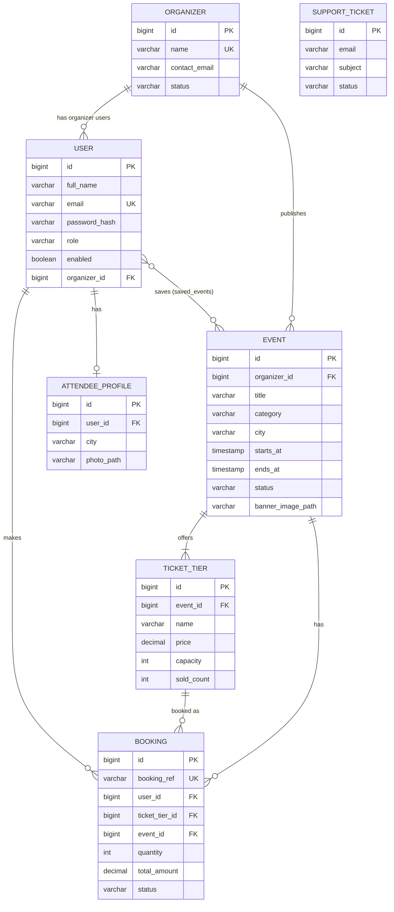

# EventPass — Project Plan

> Event ticketing REST API. Organizers publish events with ticket tiers; attendees discover, save and book tickets; admins approve organizers and handle support.
> **Headline engineering problem:** no overselling under concurrent bookings — proven by an automated concurrency test.

---

## 1. Summary

| Item | Decision |
|---|---|
| Type | Backend-only REST API (no frontend) — modular monolith, layered |
| Stack | Java 25 (LTS) · Spring Boot 4.x · Spring Framework 7 · Spring Security 7 · Spring Data JPA (Hibernate 7) · MySQL 8.4 · Maven |
| Schema | Flyway migrations (Hibernate `ddl-auto=validate`) |
| Auth | Stateless JWT (Bearer token), BCrypt passwords |
| Errors | One consistent JSON: RFC 9457 `ProblemDetail` |
| Docs | SpringDoc OpenAPI / Swagger UI |
| Testing | JUnit 5 · MockMvc (`MockMvcTester`) · `@DataJpaTest` · Testcontainers (real MySQL) · concurrency test |
| DevOps | Docker Compose (dev DB) · GitHub Actions CI · Dockerfile · live deployment |
| Money / time | `BigDecimal` prices, single currency (USD) · all timestamps `Instant` in UTC, ISO-8601 in JSON |

**Out of scope (on purpose):** real payments (booking = confirmed instantly), seat maps, microservices/Kafka, frontend.
**Stretch (only after MVP):** idempotency key on booking, email confirmation, waitlist, rate limiting, reviews, S3 file storage.

---

## 2. Roles

| Role | Mirrors (Job Portal) | Can do |
|---|---|---|
| `ATTENDEE` | Job seeker | Browse/search events, save events, book & cancel tickets, manage own profile + photo |
| `ORGANIZER` | Employer | Manage own organization's events, ticket tiers, banners; view bookings; check in attendees |
| `ADMIN` | Admin | Approve/suspend organizers, manage support tickets |
| Anonymous | — | Browse/search published events, submit a support ticket, register, log in |

> Roles are stored as an enum column on `User` (one role per user) — simple and common in real apps. No separate `roles` table.

---

## 3. Entities

All entities extend `BaseEntity` (S6 auditing): `createdAt`, `createdBy`, `updatedAt`, `updatedBy`.
IDs are `Long` (auto-increment). Public booking reference is a separate unique string.

| Entity | Key fields | Relationships |
|---|---|---|
| **User** | id, fullName, email (unique), passwordHash, role (`ATTENDEE`/`ORGANIZER`/`ADMIN`), enabled | `@ManyToOne` Organizer (nullable — only for organizer users) · `@ManyToMany` savedEvents (S17) |
| **Organizer** | id, name (unique), description, website, contactEmail, status (`PENDING`/`APPROVED`/`SUSPENDED`) | `@OneToMany` events · has many organizer users |
| **Event** | id, title, description, category (`MUSIC`/`TECH`/`SPORTS`/`COMEDY`/`WORKSHOP`/`OTHER`), venueName, city, address, startsAt, endsAt, status (`DRAFT`/`PUBLISHED`/`CANCELLED`), bannerImagePath | `@ManyToOne(LAZY)` Organizer · `@OneToMany(cascade=ALL, orphanRemoval)` ticketTiers |
| **TicketTier** | id, name ("VIP"), price, capacity, soldCount | `@ManyToOne(LAZY)` Event |
| **Booking** | id, bookingRef (unique, e.g. `EVP-8F3K2A`), quantity, unitPrice, totalAmount, status (`CONFIRMED`/`CANCELLED`/`CHECKED_IN`), cancelledAt, checkedInAt | `@ManyToOne(LAZY)` User · `@ManyToOne(LAZY)` TicketTier · `@ManyToOne(LAZY)` Event (denormalized for fast per-event queries) |
| **AttendeeProfile** | id, phone, city, bio, photoPath | `@OneToOne` User (S17) |
| **SupportTicket** | id, name, email, subject, message, status (`NEW`/`CLOSED`), closedAt | none (public form, like Contact Us) |
| *saved_events* (join table) | user_id, event_id (composite PK) | `User` ↔ `Event` `@ManyToMany` — no extra columns, so many-to-many is correct here |

> **Why Booking is NOT `@ManyToMany`:** it carries its own data (quantity, price, status, timestamps). Any join with extra data must be a real entity. (S17 lesson.)

### ER diagram



---

## 4. Business rules

| # | Rule | Where enforced | Section |
|---|---|---|---|
| BR1 | **No overselling:** `soldCount + qty ≤ capacity`, atomic under concurrent requests (conditional `UPDATE … WHERE sold_count + :qty <= capacity`) | Service + `@Modifying` query in a `@Transactional` method | S15 → S17 |
| BR2 | Max **6 tickets** per attendee per event (across bookings) | Booking service | S17 |
| BR3 | Only `PUBLISHED` events that haven't started can be booked | Booking service | S17 |
| BR4 | Cancel allowed until **24h** before `startsAt`; returns tickets to inventory | Booking service (transactional) | S17 |
| BR5 | Organizer must be `APPROVED` to publish events | Event management service | S15/S16 |
| BR6 | Suspending an organizer unpublishes **all** their events in one transaction | Admin service | S15 |
| BR7 | Organizers can modify **only their own organization's** events/tiers/bookings → else 403/404 | Service ownership check | S14/S16 |
| BR8 | Only `DRAFT` events can be deleted; published events must be cancelled. Cancelling an event cancels all its bookings | Event management service | S16/S17 |
| BR9 | Booking status flow: `CONFIRMED → CHECKED_IN` (organizer) or `CONFIRMED → CANCELLED` (attendee/event cancel); nothing else | Booking/Organizer services | S17/S18 |
| BR10 | Email unique (409 on duplicate); compromised passwords rejected | Registration | S10 |
| BR11 | Support ticket flow: `NEW → CLOSED` (admin) | Admin support service | S14 |

---

## 5. Endpoints

Base path: **`/api/v1`**. "Public" = no token. Lists marked 📄 are paged + sortable (from S14).

### Auth & public
| Method | Path | Role | Purpose | Sec |
|---|---|---|---|---|
| POST | `/auth/register` | Public | Register attendee → 201 | S10 |
| POST | `/auth/register/organizer` | Public | Register organizer user + organization (`PENDING`) → 201 | S10 |
| POST | `/auth/login` | Public | Email + password → JWT | S9/S10 |
| GET | `/events` 📄 | Public | Search published upcoming events (`city`, `category`, `from`, `to`, `q`) | S1→S13→S14 |
| GET | `/events/{eventId}` | Public | Event details + tiers + availability (cached) | S1→S7→S16 |
| GET | `/events/{eventId}/banner` | Public | Download banner image | S17 |
| POST | `/support-tickets` | Public | Submit support ticket → 201 | S5/S6 |

### Attendee (`ATTENDEE`)
| Method | Path | Purpose | Sec |
|---|---|---|---|
| GET / PUT | `/me/profile` | View / update own profile | S17 |
| PUT / GET | `/me/profile/photo` | Upload (multipart) / download photo | S17 |
| GET | `/me/saved-events` 📄 | List saved events | S17 |
| PUT / DELETE | `/me/saved-events/{eventId}` | Save / unsave (idempotent → 204) | S17 |
| POST | `/bookings` | Book `{ticketTierId, quantity}` → 201 / 409 sold out | S17 |
| GET | `/me/bookings` 📄 | My bookings | S17 |
| GET | `/bookings/{bookingRef}` | One booking (owner only) | S17 |
| POST | `/bookings/{bookingRef}/cancel` | Cancel (24h rule) | S17 |

### Organizer (`ORGANIZER`)
| Method | Path | Purpose | Sec |
|---|---|---|---|
| GET / PUT | `/organizer/profile` | View / update own organization | S16 |
| GET | `/organizer/events` 📄 | Own events (any status) | S16 |
| POST | `/organizer/events` | Create draft event → 201 + Location | S16 |
| PUT | `/organizer/events/{eventId}` | Update event (evicts cache) | S16 |
| DELETE | `/organizer/events/{eventId}` | Delete draft → 204 | S16 |
| POST | `/organizer/events/{eventId}/publish` | Publish (needs ≥1 tier, APPROVED org) | S16 |
| POST | `/organizer/events/{eventId}/cancel` | Cancel event (+ cancel bookings from S17) | S16/S17 |
| POST | `/organizer/events/{eventId}/tiers` | Add tier | S16 |
| PUT / DELETE | `/organizer/events/{eventId}/tiers/{tierId}` | Update / remove tier (no remove if sold > 0) | S16 |
| PUT | `/organizer/events/{eventId}/banner` | Upload banner (multipart) | S17 |
| GET | `/organizer/events/{eventId}/bookings` 📄 | Attendee list for an event | S18 |
| POST | `/organizer/bookings/{bookingRef}/check-in` | Check in attendee | S18 |

### Admin (`ADMIN`)
| Method | Path | Purpose | Sec |
|---|---|---|---|
| GET | `/admin/organizers?status=PENDING` 📄 | List organizers by status | S15 |
| POST | `/admin/organizers/{organizerId}/approve` | Approve | S15 |
| POST | `/admin/organizers/{organizerId}/suspend` | Suspend + unpublish all events (one tx) | S15 |
| GET | `/admin/support-tickets?status=NEW` 📄 | List tickets, newest first | S14 |
| PATCH | `/admin/support-tickets/{ticketId}` | Close ticket `{status: "CLOSED"}` | S14 |

---

## 6. Course → EventPass mapping

| Course feature (Job Portal) | EventPass feature | Section |
|---|---|---|
| REST basics, API versioning | `/api/v1/events` read API | S1 |
| H2, schema.sql/data.sql | **Industry swap:** MySQL in Docker + Flyway migrations & dev seed | S2 |
| Entities, repositories, DTOs, CORS | Event/Organizer/TicketTier entities, DTO records | S3 |
| MySQL in Docker, Compose support | `compose.yaml` auto-started by Spring Boot | S4 |
| Contact Us API, ddl-auto | Support tickets · `ddl-auto=validate` (Flyway owns schema) | S5 |
| Exceptions, validation, auditing, OpenAPI | `ProblemDetail` errors, Bean Validation, `BaseEntity` auditing, Swagger | S6 |
| Company ↔ Jobs, bulk test data | Organizer ↔ Events ↔ TicketTiers, generated seed data | S7 |
| Security basics, filter chain, CORS | Public browsing vs protected API | S8 |
| PasswordEncoder, login API, JWT | BCrypt, `/auth/login`, JWT filter | S9 |
| Users/roles, registration, DB auth, CSRF | Attendee/organizer registration, DB login | S10 |
| Logging | SLF4J, per-profile Logback, request id | S11 |
| AOP | Timing aspect, `@Audited` business-action logs | S12 |
| Advanced queries, N+1 | Event search, fetch joins, batch fetching | S13 |
| Authorization, 401/403, paging, contact NEW→CLOSED | Role rules, JSON 401/403, paged search, support ticket close | S14 |
| Transactions, admin company & employer mgmt | Approve/suspend organizers (atomic) | S15 |
| Caching, employer job-management APIs | Organizer event-management APIs, cached event details | S16 |
| Profiles, uploads, save/unsave, apply/withdraw | Attendee profile + photo, banners, save/unsave event, **book/cancel tickets** | S17 |
| Config & environments, employer manages applications | `@ConfigurationProperties`, dev/test/prod, organizer attendee list + check-in | S18 |

---

## 7. Roadmap

You have finished **S1–S13** in the course, so S1–S13 are built as a fast **catch-up phase** (C1–C6) in real-industry order — no throwaway TEMPs for already-learned concepts (no in-memory Map, no H2). From **S14** we follow the course live.

Every step ends with a test (JUnit 5 / MockMvc / Testcontainers) and a Conventional Commit. CI runs all tests on every push from C1.

### Catch-up phase (S1–S13)

#### C1 — Project setup · covers S1, S2
- **Gets:** Spring Boot 4 project, package-by-feature skeleton, Git + `.gitignore`, README skeleton, GitHub Actions CI (`./mvnw verify`).
- **Concepts:** starters, `@SpringBootApplication`, auto-configuration, DevTools, readable logs.
- **✍️ Skills:** none heavy — setup is 📋. You write the first README "Why this project" paragraph.
- **DoD:** `./mvnw spring-boot:run` starts; `./mvnw verify` green locally and in GitHub Actions.

#### C2 — Database + catalog read API · covers S1, S2, S3, S4, S5 (DDL), S7
- **Gets:** `compose.yaml` (MySQL 8.4 + volume, auto-started by Spring Boot Docker Compose support), Flyway `V1__init.sql`, dev seed data (≈20 organizers, 200 events, 500 tiers), `Organizer`/`Event`/`TicketTier` entities, repositories, DTO records + mappers, `GET /events`, `GET /events/{id}`, CORS config, API versioning.
- **Concepts:** `@RestController`, `ResponseEntity`, `@PathVariable`/`@RequestParam`, versioning, `@Entity`/`@Table`/`@Column`, Lombok (safe use on entities), DTO pattern, `@OneToMany`/`@ManyToOne`, LAZY fetch, cascade + orphanRemoval, `ddl-auto=validate`, `open-in-view=false`.
- **✍️ Skills:** entities + relationships, repository interfaces, DTO records + mapping, controller with correct status codes.
- **DoD:** `GET /api/v1/events` → 200 list of DTOs; `GET /api/v1/events/999999` → 404; `@DataJpaTest` + Testcontainers repository test green; `@WebMvcTest` controller test green.
- **TEMP:** list not paged (T2) · 404 handled locally until C3.

#### C3 — Support tickets + production essentials · covers S5, S6
- **Gets:** `POST /support-tickets`, `@RestControllerAdvice` returning `ProblemDetail`, Bean Validation on all request DTOs, `BaseEntity` JPA auditing, SpringDoc Swagger UI.
- **Concepts:** global exception handling, `@Valid`, custom exceptions, `@CreatedDate`/`@CreatedBy` + `AuditorAware`, OpenAPI, bean scopes (explained).
- **✍️ Skills:** custom exceptions + handler, validation annotations, create endpoint returning 201 + `Location`.
- **DoD:** valid POST → 201; invalid → 400 `ProblemDetail` with field errors; unknown event → 404 `ProblemDetail`; Swagger at `/swagger-ui.html`.
- **TEMP:** `AuditorAware` returns `"system"` until C4 (T1).

#### C4 — Security, JWT, registration · covers S8, S9, S10
- **Gets:** stateless `SecurityFilterChain`, BCrypt, `User` entity, `/auth/register`, `/auth/register/organizer`, `/auth/login` → JWT, JWT validation filter, compromised-password check, DB-backed authentication. `AuditorAware` reads the logged-in user (replaces T1).
- **Concepts:** filter chain, `permitAll`/`authenticated`, CSRF (why it's disabled for stateless JWT APIs), CORS in Security, hashing vs encryption, `PasswordEncoder`, `AuthenticationManager`, JWT structure/signature, derived queries (`existsByEmail`), custom `AuthenticationProvider` / `UserDetailsService`.
- **✍️ Skills:** security rules, registration + duplicate check, login logic, JWT filter core, `UserDetailsService`.
- **DoD:** register → 201; duplicate email → 409; pwned password → 400; login → 200 `{accessToken}`; `/me/**` without token → 401; with token → passes.
- **TEMP:** role checks are only `authenticated()` (T3) · default 401/403 bodies (T4) · JWT secret/expiry in a constants class, dev-only value (T5).

#### C5 — Logging + AOP · covers S11, S12
- **Gets:** SLF4J logging in services, `logback-spring.xml` (console for dev, rolling file for prod), request-id in logs (MDC filter), `@Around` timing aspect for services, `@AfterThrowing` error logging, custom `@Audited` annotation pointcut.
- **Concepts:** log levels, appenders, aspect/advice/pointcut, `execution()` vs annotation pointcuts.
- **✍️ Skills:** pointcuts + advice bodies, meaningful log statements (no secrets/PII).
- **DoD:** every log line carries a request id; slow methods (>500 ms) log WARN; a test asserts the aspect runs.

#### C6 — Event search + N+1 · covers S13
- **Gets:** `GET /events?city=&category=&from=&to=&q=` with JPQL `@Query`, N+1 demonstrated then fixed (`JOIN FETCH` / `@EntityGraph` / `default_batch_fetch_size`), one native query (organizer stats), one `@NamedQuery`.
- **Concepts:** limits of derived queries, JPQL, native queries, named queries, N+1, batch fetching.
- **✍️ Skills:** JPQL with optional filters, fetch-join query.
- **DoD:** filters work in combination; SQL log shows a constant number of queries (not N+1); repository tests cover each filter.
- **TEMP:** search returns an unpaged list (T2).

### Live phase (follow the course)

#### S14 — Authorization & data handling
- **Gets:** role rules (`hasRole`) per URL group + method security where needed, ownership checks, JSON 401/403 (`AuthenticationEntryPoint`, `AccessDeniedHandler`), pagination + sorting (stable `PageResponse` DTO), admin support-ticket list + close (`NEW → CLOSED`).
- **Concepts:** authentication vs authorization, roles vs authorities, `hasRole`, custom 401/403, `Pageable`/`Sort`.
- **✍️ Skills:** authorization rules, paged repository methods, close-ticket logic.
- **DoD:** attendee → `/admin/**` = 403 JSON; no token = 401 JSON; `GET /events?page=0&size=10&sort=startsAt,asc` returns a page; security tests for each role.
- **Replaces:** T2, T3, T4.

#### S15 — Transactions
- **Gets:** `@Transactional` on service layer (class-level `readOnly = true`, write methods override), admin organizer APIs (list, approve, suspend → unpublish all events atomically), `@Modifying` bulk update, inventory "reserve seats" conditional update (used in S17).
- **Concepts:** proxy internals, readOnly, `@Modifying`, rollback rules (checked vs runtime), propagation, isolation, self-invocation pitfall.
- **✍️ Skills:** transaction boundaries, bulk update queries, admin service logic.
- **DoD:** suspend organizer → org + all events updated in one tx; forced exception mid-way → nothing changes (test proves rollback).
- **Replaces:** services without explicit transactions.

#### S16 — Caching + organizer event management
- **Gets:** organizer APIs (create draft, update, delete draft, publish, cancel, tiers CRUD) with ownership checks; `@Cacheable` event details, `@CacheEvict` on change, Caffeine with TTL.
- **Concepts:** `@Cacheable`, `@CachePut`, `@CacheEvict`, TTL, Caffeine.
- **✍️ Skills:** event management services, publish/cancel rules (BR5, BR7, BR8), cache annotations.
- **DoD:** second `GET /events/{id}` runs no SQL; updating the event evicts it; organizer A editing organizer B's event → 404/403.

#### S17 — Profiles, uploads, saved events, bookings ⭐
- **Gets:** `AttendeeProfile` + photo upload, event banner upload (type/size validated, stored via a `FileStorageService` interface on local disk), saved events (`@ManyToMany`), **bookings**: book, list, view, cancel; event cancel cancels bookings.
- **Concepts:** profile entities, multipart uploads, `@ManyToMany` and when NOT to use it.
- **✍️ Skills:** booking service with BR1–BR4, many-to-many mapping, upload validation.
- **DoD:** **concurrency test:** capacity 10, 50 parallel booking requests → exactly 10 succeed, 40 get 409, `sold_count = 10`. Cancel restores inventory. Upload rejects a 20 MB `.exe`.
- **TEMP:** max tickets (6), cancel window (24h) and upload dir are constants (T6).

#### S18 — Configuration & environments
- **Gets:** `@ConfigurationProperties` (`app.jwt.*`, `app.booking.*`, `app.storage.*`, `app.cors.*`), secrets from env vars, profiles `dev`/`test`/`prod`, `@Profile` beans (dev seed loader), Logback per profile, organizer attendee list + check-in.
- **Concepts:** `@Value`, `Environment`, `@ConfigurationProperties`, `@PropertySource`, env/JVM/CLI args, profiles, conditional beans.
- **✍️ Skills:** typed config classes, profile-specific beans, check-in logic (BR9).
- **DoD:** app runs with `SPRING_PROFILES_ACTIVE=prod` and env vars only; **no secrets in the repo**; check-in works once, second time → 409.
- **Replaces:** T5, T6.

### Final — Ship it
- Dockerfile (multi-stage) · live deployment with public Swagger UI · demo accounts per role · Postman collection.
- README: 30-second summary, live demo link, architecture + ER diagrams, "Engineering decisions" (overselling, N+1, caching, transactions), how to run, test badge.

---

## 8. Package structure & conventions

Package-by-feature (each feature owns its controller, service, repository, entity, DTOs):

```
com.eventpass
├── EventPassApplication.java
├── common/            # BaseEntity, ProblemDetail handler, exceptions, PageResponse, config (CORS, OpenAPI, JPA auditing)
├── security/          # SecurityConfig, JwtService, JwtAuthFilter, 401/403 handlers
├── auth/              # AuthController, AuthService, register/login DTOs
├── user/              # User, Role, UserRepository, AttendeeProfile, profile API
├── organizer/         # Organizer, OrganizerController (organizer self), AdminOrganizerController
├── event/             # Event, TicketTier, public EventController, OrganizerEventController, search
├── booking/           # Booking, BookingController, BookingService, OrganizerBookingController
├── support/           # SupportTicket, SupportTicketController, AdminSupportTicketController
├── storage/           # FileStorageService (+ local impl)
└── logging/           # aspects, request-id filter
```

**Naming**
- Classes: `EventController`, `EventService`, `EventRepository`; DTOs as records: `EventResponse`, `CreateEventRequest`, `EventSummary`.
- Exceptions: `ResourceNotFoundException`, `DuplicateEmailException`, `SoldOutException`, `BusinessRuleException` → mapped to `ProblemDetail`.
- REST: plural nouns, kebab-case paths (`/support-tickets`), actions as sub-resources only when needed (`/publish`, `/cancel`, `/check-in`).
- DB: snake_case tables/columns, plural tables (`events`, `ticket_tiers`); Flyway files `V{n}__{description}.sql`.
- Status codes: 200 read/update · 201 create (+ `Location`) · 204 delete/no body · 400 validation · 401 no/invalid token · 403 wrong role · 404 not found / not yours · 409 conflict (duplicate, sold out, invalid state).
- Commits: Conventional Commits (`feat(booking): prevent overselling with conditional update`).
- Tests: `*Test` (unit/slice), `*IT` (Testcontainers integration).
